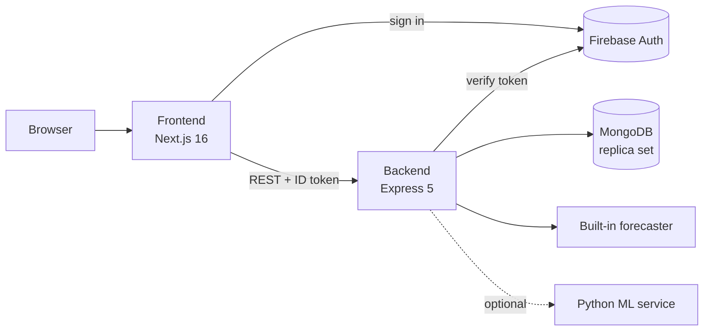

<div align="center">


# ProcuraX

**Intelligent Procurement. Smarter Inventory. Better Decisions.**

AI-assisted e-procurement, inventory and MRP platform for steel manufacturing.

*Independent demo prototype on synthetic data. Not affiliated with any steel manufacturer; no confidential or proprietary data.*

</div>

---

## Contents
1. [What it does](#1-what-it-does)
2. [Architecture](#2-architecture)
3. [Tech stack](#3-tech-stack)
4. [Quick start (local)](#4-quick-start-local)
5. [Demo data and demo logins](#5-demo-data-and-demo-logins)
6. [Environment variables](#6-environment-variables)
7. [Deploy: Render + Vercel + Atlas](#7-deploy-render--vercel--atlas)
8. [Roles and permissions](#8-roles-and-permissions)
9. [Key business rules](#9-key-business-rules)
10. [Machine learning (free, built in)](#10-machine-learning-free-built-in)
11. [Testing](#11-testing)
12. [Project structure](#12-project-structure)
13. [Honest limitations](#13-honest-limitations)
14. [More documentation](#14-more-documentation)

## 1. What it does

| Area | Features |
|---|---|
| **Procurement** | Purchase requisitions, multi-step approvals (department, procurement, finance by value), RFQs, **sealed** supplier quotations, landed-cost comparison, **manual** award, purchase orders, goods receipt (accepted / rejected), supplier invoices with three-way match |
| **Inventory** | Material catalogue, warehouses, stock levels, movement ledger, issues, transfers, adjustments, reorder alerts |
| **Planning** | Finished products, bills of materials (versioned), production plans, **MRP** with reservations and reorder recommendations |
| **Intelligence** | Demand and price forecasting, risk detection, supplier scoring and performance, data-grounded assistant |
| **Governance** | Role-based access enforced by the backend, append-only audit log, notifications, 12 reports with CSV / Excel / PDF export, document uploads |
| **Admin** | User management (role, status, department, supplier link), departments (create, rename, deactivate), approval / MRP / scoring settings |

## 2. Architecture



Backend layers: `routes → services → domain (pure rules) → models`. Full diagrams (request pipeline, workflow, data model, forecasting, deployment) are in [docs/architecture.md](docs/architecture.md).

## 3. Tech stack

| Layer | Technology |
|---|---|
| Frontend | Next.js 16, React, TypeScript, Tailwind, Recharts, TanStack Table, react-hook-form + zod |
| Backend | Express 5, Mongoose 9, zod 4, decimal.js, pdfkit, exceljs |
| Database | MongoDB (replica set, for transactions) |
| Auth | Firebase Authentication (identity only) + database-backed RBAC |
| ML | Built-in TypeScript forecaster; optional Python / FastAPI service (scikit-learn, XGBoost) |
| Tests | Jest + supertest (backend), Vitest + Testing Library (frontend), pytest (ML) |
| Deploy | Docker Compose, or Render + Vercel + MongoDB Atlas |

## 4. Quick start (local)

**Prerequisites:** Node 20+, a MongoDB **replica set** (Docker below, or Atlas), a Firebase project (see [docs/firebase-setup.md](docs/firebase-setup.md)).

```bash
# 1. MongoDB (single-node replica set)
docker compose up -d

# 2. Backend
cd backend
cp .env.example .env        # fill in Firebase values, BOOTSTRAP_ADMIN_EMAIL
npm install
npm run seed                # master data + demo users + demo workflow data (safe to re-run)
npm run dev                 # http://localhost:5000

# 3. Frontend (new terminal)
cd frontend
cp .env.example .env.local  # fill in NEXT_PUBLIC_FIREBASE_* values
npm install
npm run dev                 # http://localhost:3000
```

Open http://localhost:3000 and sign in with a demo account below. No ML service is needed.

## 5. Demo data and demo logins

`npm run seed` is **idempotent** (run it again any time) and marks everything as DEMO. It creates the Firebase demo users automatically through the Admin SDK.

| Role | Email | 
|---|---|
| System Administrator | `admin@demo.steelprocure.example` |
| Procurement Manager | `procurement@demo.steelprocure.example` |
| Department Manager | `deptmanager@demo.steelprocure.example` |
| Inventory Officer | `inventory@demo.steelprocure.example` |
| Finance Officer | `finance@demo.steelprocure.example` |
| Management | `executive@demo.steelprocure.example` |
| Supplier (SUP-0001 / 2 / 3) | `supplier@…`, `supplier2@…`, `supplier3@…` `.demo.steelprocure.example` |

Password for all: `demo@12345`. Show or hide the login helper box with `NEXT_PUBLIC_SHOW_DEMO_LOGINS`. **Never use these accounts in a real deployment.**

(The `steelprocure` domain and database name are kept from the project's earlier name so existing accounts and data keep working.)

### What the seed gives you to test

10 categories, 35 materials, 10 suppliers (one unproven, one unverified, one blocked), 3 warehouses with opening stock, price and consumption history, BOMs, production plans, reservations, plus 19 workflow scenarios:

| Ref | State | Try it on |
|---|---|---|
| R01 | Draft | Edit / submit |
| R02 – R04 | Waiting for department / procurement / finance approval | Approvals page per role |
| R05 / R06 | Modification requested / rejected | Resubmit flow |
| R07, R08 | **Approved, no RFQ yet** | **Create RFQ** |
| R09, R10 | Open RFQ | Supplier logins submit sealed quotes |
| R11 | Closed RFQ, 3 quotes | Compare and **award** |
| R12 | Awarded | Create PO |
| R13 | Draft PO | Issue |
| R14, R15 | Issued PO (R15 overdue) | **Record receipt**, delayed-delivery report |
| R16 | Partially received, with rejection | Receive the rest, short-close |
| R17, R18, R19 | Received; invoice pending / verified / disputed | Invoice verification |

It also adds stock-ledger entries, about 20 notifications, an MRP run, a risk scan and forecasts.

## 6. Environment variables

### Backend (`backend/.env`)

| Variable | Purpose |
|---|---|
| `NODE_ENV`, `PORT` | `production` on Render |
| `MONGODB_URI` | Connection string, database `steelprocure`, replica set required |
| `FRONTEND_URL` | Exact frontend origin for CORS; `https://…` in production |
| `FIREBASE_PROJECT_ID`, `FIREBASE_CLIENT_EMAIL`, `FIREBASE_PRIVATE_KEY` | Admin SDK credentials (private key on one line with literal `\n`) |
| `BOOTSTRAP_ADMIN_EMAIL` | First user with this email becomes System Administrator |
| `ML_MODE` | `auto` (default), `builtin` (never call Python), `service` (require it) |
| `ML_SERVICE_URL`, `ML_INTERNAL_KEY`, `ML_TIMEOUT_MS` | Only for the optional Python service |
| `STORAGE_DRIVER`, `UPLOAD_DIR`, `MAX_UPLOAD_MB` | Document uploads (local disk) |

### Frontend (`frontend/.env.local`)

| Variable | Purpose |
|---|---|
| `NEXT_PUBLIC_API_URL` | Backend base URL including `/api/v1` |
| `NEXT_PUBLIC_FIREBASE_API_KEY`, `_AUTH_DOMAIN`, `_PROJECT_ID`, `_APP_ID` | Firebase web config |
| `NEXT_PUBLIC_SHOW_DEMO_LOGINS` | `true` to show the demo accounts box |

`NEXT_PUBLIC_*` values are baked in at build time: redeploy after changing them.

## 7. Deploy: Render + Vercel + Atlas

1. **Atlas:** create a free M0 cluster, allow `0.0.0.0/0` in Network Access, copy the `mongodb+srv://…/steelprocure` URI.
2. **Render (backend):** Web Service, root `backend`, build `npm install && npm run build`, start `npm start`. Set `NODE_ENV=production`, `MONGODB_URI`, `FRONTEND_URL`, the three Firebase variables, `BOOTSTRAP_ADMIN_EMAIL`, `ML_MODE=builtin`. Check `/health`.
3. **Vercel (frontend):** root `frontend`, set the `NEXT_PUBLIC_*` variables, deploy.
4. **Firebase:** Authentication → Settings → Authorized domains → add your Vercel domain.
5. **Seed:** from your own computer, point `MONGODB_URI` in `backend/.env` at Atlas and run `npm run seed`.

Free-tier caveats: Render sleeps when idle (first request takes about a minute), and its disk is wiped on redeploy, so **uploaded documents do not persist**. Docker deployment: [docs/deployment.md](docs/deployment.md).

## 8. Roles and permissions

| Role | Main abilities |
|---|---|
| System Administrator | Everything |
| Procurement Manager | Approve, RFQ, compare and award, POs, suppliers, MRP, risks |
| Department Manager | Create and approve requisitions for their department |
| Inventory Officer | Materials, warehouses, receipts, stock operations, production plans, BOM |
| Finance Officer | Approve high-value requisitions, verify invoices, financial reports |
| Supplier | Only invited RFQs, sealed quotes, own POs and profile |
| Management | Read-only dashboards, forecasts, reports |

Permissions live in MongoDB and are enforced on every API call. Nothing is hard-deleted: records are deactivated, cancelled or marked obsolete so the audit trail stays intact.

## 9. Key business rules

- **Landed cost** = material cost + transport + additional charges + tax (tax % × material cost); each part rounded to 2 dp, exact decimals throughout.
- **Approval chain:** department manager (skipped if the requester is one) → procurement manager → finance officer when the estimated total exceeds 1,000,000.
- **Sealed bids:** no quote is visible to other suppliers, or to staff, before the deadline.
- **Award is manual**, with a written justification; the system never picks a supplier.
- **Supplier reliability:** fewer than 5 completed orders is never treated as reliable.
- **Three-way match:** invoice price must equal PO price; billed quantity cannot exceed accepted-and-not-yet-invoiced quantity; mismatches can only be disputed.
- **Receipts** add only accepted quantity to stock, with a ledger entry in the same transaction.

Formulas for MRP, scoring, forecasting and risks: [docs/phase-notes.md](docs/phase-notes.md).

## 10. Machine learning (free, built in)

No paid API, no external service. The backend forecasts demand (moving average, exponential smoothing, picked by rolling backtest) and price (linear trend with interval). With under 8 weeks of data it answers `insufficient_data` instead of inventing numbers. Results are always labelled as forecasts with a model version.

The optional Python service (`ml/`) adds random forest and XGBoost. Use `ML_MODE=auto` with `ML_SERVICE_URL` and `ML_INTERNAL_KEY`; if it is down, the built-in forecaster answers.

## 11. Testing

```bash
cd backend  && npm test && npm run typecheck     # Jest (610 tests)
cd frontend && npm test && npm run typecheck     # Vitest (142 tests)
cd ml       && pip install -r requirements-dev.txt && pytest
```

Backend tests cover pure rules, services with mocked models, the seed against an in-memory fake, and route permissions.

## 12. Project structure

```
backend/   Express API  (src/routes, services, domain, models, middlewares) + scripts/ (seed)
frontend/  Next.js app  (app/ pages, features/, components/, lib/api)
ml/        Optional FastAPI forecasting service
docs/      architecture, deployment, backup/restore, Firebase setup, phase notes
scripts/   backup.sh, restore.sh
data/      synthetic data
```

## 13. Honest limitations

- Synthetic data only; a prototype, not production software.
- Seed and workflow were verified by automated tests and a real seed run on a developer machine; **no browser end-to-end tests, no load tests**.
- Docker images and backup/restore scripts have not been run end to end.
- Uploaded documents use local disk (lost on Render redeploys).
- Random forest and XGBoost need the optional Python service.
- Backend lint has no ESLint config yet.

## 14. More documentation

- [Architecture diagrams](docs/architecture.md)
- [Deployment (Docker)](docs/deployment.md) · [Backup and restore](docs/backup-restore.md)
- [Firebase setup](docs/firebase-setup.md)
- [Phase notes, formulas and rules](docs/phase-notes.md)
