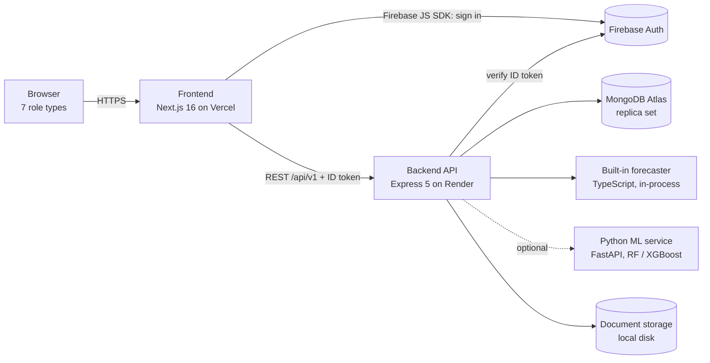
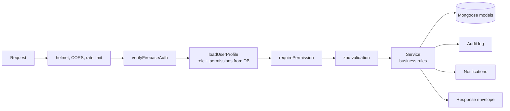
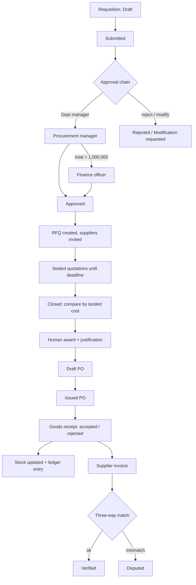
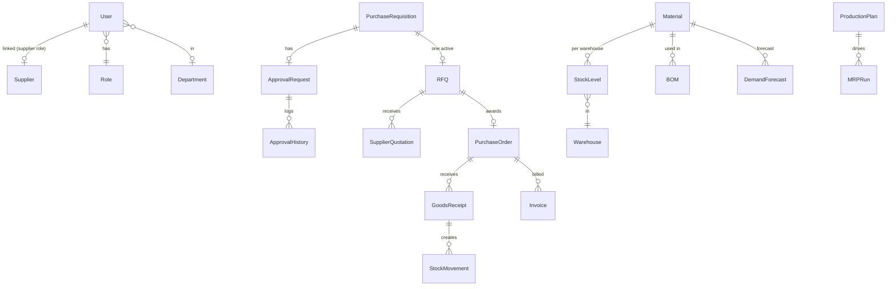
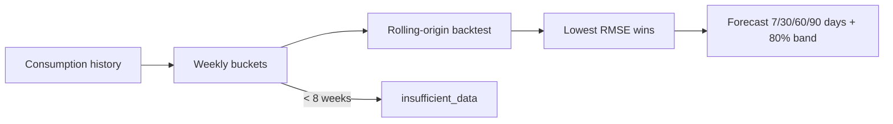

# ProcuraX – System Architecture

## 1. Big picture

* The **frontend** never talks to MongoDB. It signs in with Firebase, then sends the Firebase ID token to the API.
* The **backend** verifies the token, loads the user and role **from MongoDB**, and checks the permission on every route. A role sent by the client is ignored.
* **Forecasting** runs inside the backend (free, offline). The Python service is optional (`ML_MODE=auto|builtin|service`).

## 2. Request pipeline (backend)

Layers: `routes` (HTTP only) → `services` (rules, transactions) → `domain` (pure functions, no database, heavily tested) → `models`. Audit entries and notifications are written after the business change commits.

## 3. Procurement workflow

## 4. Data model (main collections)

Other collections: `Notification`, `AuditLog` (append-only), `DocumentFile`, `RiskAlert`, `PriceHistory`, `ConsumptionHistory`, `Counter` (document numbers), `Settings`.

## 5. Roles and what they can do

| Role | Main abilities |
|---|---|
| System Administrator | Everything: users, departments, settings, audit, all master data and workflow |
| Procurement Manager | Approve requisitions, run RFQs, compare and award, POs, supplier management, MRP, risk review |
| Department Manager | Create and approve requisitions for their department, view POs and stock |
| Inventory Officer | Materials, warehouses, goods receipt, stock issue/transfer/adjust, production plans, BOM |
| Finance Officer | Approve high-value requisitions, verify or dispute invoices, financial reports, bank details |
| Supplier | See only RFQs they are invited to, submit sealed quotes, see their own POs and profile |
| Management | Read-only dashboards, stock, forecasts, intelligence and reports |

Permissions are stored in MongoDB (`roles` collection) and enforced by the backend; the UI only hides what the backend would refuse.

## 6. Security rules built in

* No custom JWT and no stored passwords (Firebase handles identity).
* Backend enforces permissions; the client role is never trusted.
* Sealed bids: quotes are hidden from other suppliers and from staff until the RFQ deadline.
* Supplier award is always a manual human decision with a written justification.
* Exact decimal money (`decimal.js`, Decimal128).
* A supplier with fewer than 5 completed orders is never scored as reliable.
* Append-only audit log with secret redaction; notifications never reveal supplier or price.
* Production start refuses placeholder secrets, missing Firebase credentials or a non-https frontend URL.

## 7. Forecasting

Built-in: moving average, exponential smoothing, linear price trend. Optional Python service adds random forest and XGBoost. Every result is labelled as a forecast, with the model version.

## 8. Deployment topology

| Part | Where | Notes |
|---|---|---|
| Frontend | Vercel | `NEXT_PUBLIC_*` variables baked in at build time |
| Backend | Render web service | `ML_MODE=builtin`; free plan sleeps when idle |
| Database | MongoDB Atlas | replica set is required for transactions |
| Auth | Firebase | add the Vercel domain to Authorized domains |
| ML (optional) | second Render service | not needed for the demo |

See [deployment.md](deployment.md) for Docker and [backup-restore.md](backup-restore.md).
